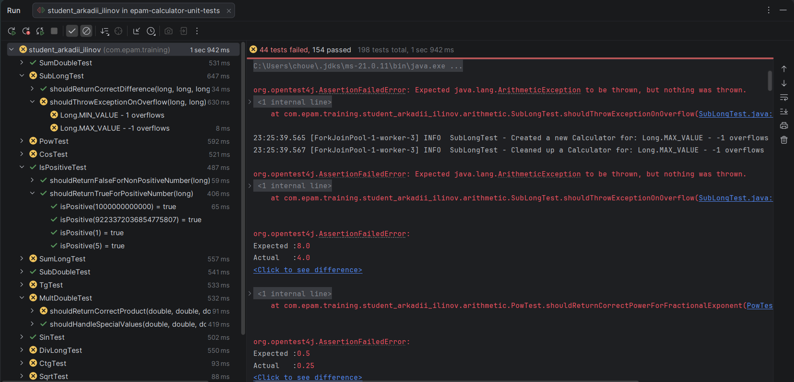

# Calculator Unit Tests

Unit tests for the Calculator-1.0.jar library.
Home task for the EPAM Automated Testing in Java course (Module: Unit Testing Frameworks).

## Tech stack

- Java 21
- Maven
- JUnit 6 (Jupiter)
- Log4j2

## Project structure

```
lib/calculator-1.0.jar                  - library under test
src/test/java/.../BaseCalculatorTest    - common setup and cleanup for all tests
src/test/java/.../arithmetic            - sum, sub, mult, div, pow, sqrt
src/test/java/.../trigonometry          - sin, cos, tg, ctg
src/test/java/.../sign                  - isPositive, isNegative
src/test/resources                      - JUnit and Log4j2 configuration
```

Each test class tests only one method of the library. Overloaded methods
(for example `sum(long, long)` and `sum(double, double)`) have separate classes.

## How to run

From the command line:

```
mvn test
```

Or in IntelliJ IDEA: right-click on `src/test/java` and choose **Run 'All Tests'**.

`BUILD FAILURE` at the end is expected: some tests fail because they find bugs
in the library (see below).

## How the tests work

- **Pre-conditions and post-conditions.** `BaseCalculatorTest` creates a new
  `Calculator` before each test (`@BeforeEach`) and removes it after each test
  (`@AfterEach`). Both steps are logged.
- **Data-driven tests.** Tests use `@ParameterizedTest` with three data sources:
  `@CsvSource`, `@MethodSource` and `@ValueSource`.
- **Parallel execution.** Configured in
  `src/test/resources/junit-platform.properties`. Test classes and test methods
  run at the same time. In the `mvn test` output, all test classes start
  together, and logs show `ForkJoinPool` worker threads.

Note: when tests run in parallel, IntelliJ IDEA and Maven Surefire show only part
of the log output. This is a known limitation of these test runners: they cannot
match output to tests that run at the same time. With
`junit.jupiter.execution.parallel.enabled = false`, all log lines are shown.

## Expected behavior

The library has no specification, so the tests use these rules:

- `long` overflow must throw `ArithmeticException`, like `Math.addExact`.
- `long` division by zero must throw `ArithmeticException`, like standard Java.
- `double` operations follow IEEE 754: overflow gives `Infinity`,
  invalid operations give `NaN`.

## Found bugs

| Method | Problem |
|---|---|
| `sum(long, long)`, `sub(long, long)`, `mult(long, long)` | Overflow gives a wrong result instead of an exception |
| `div(long, long)` | Division by zero throws `NumberFormatException` instead of `ArithmeticException`; `Long.MIN_VALUE / -1` overflow gives a wrong result |
| `mult(double, double)` | Result is rounded down: `2.5 * 2.5` returns `6.0` instead of `6.25` |
| `pow(double, double)` | Exponent is rounded down: `4 ^ 0.5` returns `1.0` instead of `2.0` |
| `sqrt(double)` | Uses the absolute value: `sqrt(-4)` returns `2.0` instead of `NaN` |
| `cos(double)` | Returns sine instead of cosine |
| `tg(double)` | Returns `1.0` for almost all angles, because it uses the broken `cos` |
| `ctg(double)` | Returns hyperbolic tangent (`tanh`) instead of cotangent |

Methods without bugs: `sum(double, double)`, `sub(double, double)`,
`div(double, double)`, `sin`, `isPositive`, `isNegative`.

Result: **198 tests, 154 passed, 44 failed**. All 44 failures are caused by the bugs above.

## Screenshots

Test results in IntelliJ IDEA:

